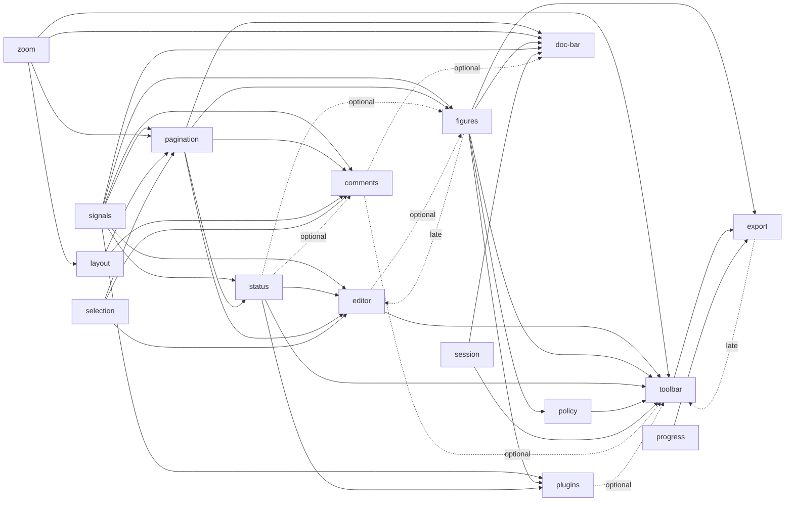

# Module dependency graph

Generated by `node build.mjs split|combine` from the factories' signatures. Do not
edit by hand; `npm run check` fails if this file is stale.

```
| id | order | requires | late / optional | provides | needed by |
| --- | --- | --- | --- | --- | --- |
| registry | 5 | — | — | _infrastructure_ | * |
| boot-ui | 6 | — | — | _infrastructure_ | * |
| apply-settings | 7 | — | — | `apply` | * |
| session | 8 | — | — | `strip`, `problems` | * |
| signals | 30 | — | — | `on`, `emit`, `mute`, `composing` | * |
| zoom | 40 | — | — | `command`, `set`, `setPercent`, `in`, `out`, `reset`, `fit`, `syncUI`, `value` | * |
| selection | 44 | — | — | `capture`, `restore`, `preserve`, `offsetIn`, `pointAt` | * |
| progress | 45 | — | — | `open`, `update`, `setText`, `setCancel`, `close`, `isOpen` | edit |
| layout | 46 | zoom | — | `origin`, `rect`, `measureH`, `viewportY`, `scale`, `pageContentTop`, `pageContentBottom` | * |
| pagination | 50 | signals, zoom, layout, selection | — | `schedule`, `pageCount`, `pageAt`, `syncFolio`, `refresh`, `setFragmenting`, `diagnostics`, `strategy`, `defineBlock`, `planSplit`, `plan` | * |
| status | 60 | signals, pagination | — | `refresh`, `save`, `markDirty`, `setStoreEstimator` | edit |
| editor | 70 | signals, status, pagination, selection | figures | `init`, `exec`, `setBlock`, `setList`, `syncToolbar`, `setFontSize`, `openLink`, `remember`, `restore`, `history`, `blockAt`, `blockAtCaret`, `insertBlock` | edit |
| comments | 76 | signals, pagination, layout, selection | status? | `init`, `mount`, `list`, `add`, `reply`, `resolve`, `remove`, `focus`, `blur`, `render`, `begin`, `counts`, `panel`, `onChange`, `canWrite`, `authorName`, `setAuthorName`, `merge`, `load` | * |
| figures | 80 | signals, pagination | status?, editor? | `init`, `pick`, `insertFiles`, `scan`, `mount`, `unmount`, `unmountAll`, `pause`, `resume`, `suspendObserver`, `resumeObserver`, `snapshot`, `captureAll`, `pluginUsage`, `insertHTML`, `setScale`, `setDimension`, `resetSize`, `remove`, `select`, `prepareClone`, `storeJSON`, `storeBytes`, `savedStoreBytes`, `store`, `selected` | * |
| policy | 85 | figures | — | `plan`, `apply`, `persist`, `presetFor`, `resolve`, `planned`, `target`, `allows`, `usage`, `blockOf`, `settingsFragment`, `PRESETS` | edit |
| toolbar | 90 | zoom, editor, figures, status, policy, session | export, comments?, plugins? | `save`, `serialize`, `validate`, `copy`, `viewer`, `settings` | edit |
| doc-bar | 92 | pagination, zoom, figures, signals, session | comments? | `save`, `sync`, `openPanel`, `openComments`, `setHidden`, `isHidden` | view, comment |
| plugins | 95 | signals, figures, status | — | `activateUi`, `wire`, `unwire`, `openPanel`, `renderPanel`, `updateCount`, `install` | edit |
| export | 100 | figures, toolbar, progress | — | `begin`, `capture`, `captureAndBuild`, `materialize`, `buildStatic`, `validateStatic`, `figureFiles`, `download`, `syncPrintPage`, `printLive`, `printCaptured` | edit |
| bootstrap | 120 | — | — | _infrastructure_ | * |
```



## Implicit edges

- None: every cross-module reference is declared.
