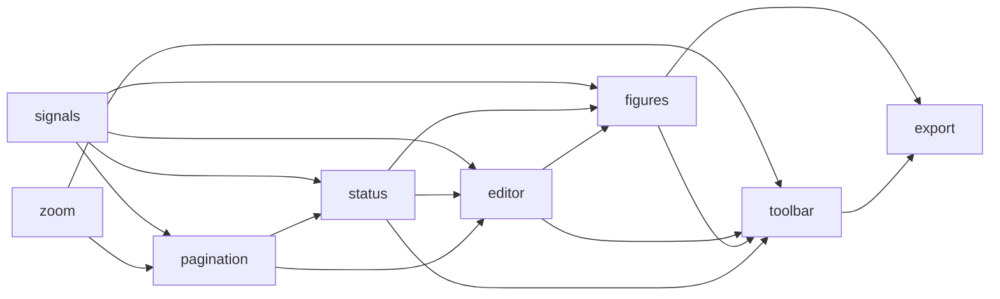

# Module dependency graph

Generated by `node build.mjs split|combine` from the factories' signatures. Do not
edit by hand; `npm run check` fails if this file is stale.

```
| id | order | requires | late | provides | needed by |
| --- | --- | --- | --- | --- | --- |
| signals | 30 | — | — | `on`, `emit`, `mute`, `composing` | * |
| zoom | 40 | — | — | `command`, `set`, `setPercent`, `in`, `out`, `reset`, `fit`, `syncUI`, `value` | * |
| pagination | 50 | signals, zoom | — | `schedule`, `pageCount`, `refresh` | * |
| status | 60 | signals, pagination | — | `refresh`, `save`, `markDirty` | edit |
| editor | 70 | signals, status, pagination | — | `init`, `exec`, `setBlock`, `setList`, `syncToolbar`, `setFontSize`, `openLink`, `remember`, `restore`, `history`, `blockAt`, `blockAtCaret`, `insertBlock` | edit |
| figures | 80 | signals, status, editor | — | `init`, `pick`, `insertFiles`, `scan`, `mount`, `unmount`, `unmountAll`, `pause`, `resume`, `suspendObserver`, `resumeObserver`, `snapshot`, `captureAll`, `setScale`, `setDimension`, `resetSize`, `remove`, `select`, `prepareClone`, `storeJSON`, `storeBytes`, `savedStoreBytes`, `store`, `selected` | * |
| toolbar | 90 | zoom, editor, figures, status | — | `save`, `serialize`, `validate` | edit, comment |
| export | 100 | figures, toolbar | — | `begin`, `capture`, `captureAndBuild`, `buildStatic`, `validateStatic`, `download`, `syncPrintPage`, `printLive`, `printCaptured` | edit |
| progress | 110 | — | — | `open`, `update`, `setText`, `setCancel`, `close`, `isOpen` | * |
```



## Implicit edges

- **status** reaches `figures` through a global (becomes `deps.late()` in Phase 3).
- **editor** reaches `figures` through a global (becomes `deps.late()` in Phase 3).
- **toolbar** reaches `export` through a global (becomes `deps.late()` in Phase 3).
- **export** reaches `progress` through a global (becomes `deps.late()` in Phase 3).
