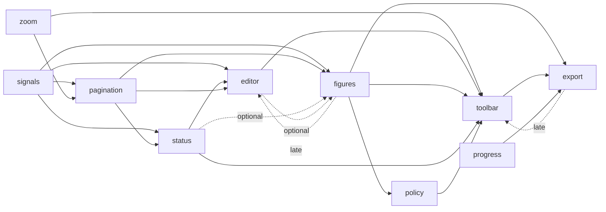

# Module dependency graph

Generated by `node build.mjs split|combine` from the factories' signatures. Do not
edit by hand; `npm run check` fails if this file is stale.

```
| id | order | requires | late / optional | provides | needed by |
| --- | --- | --- | --- | --- | --- |
| registry | 5 | — | — | _infrastructure_ | * |
| boot-ui | 6 | — | — | _infrastructure_ | * |
| apply-settings | 7 | — | — | `apply` | * |
| signals | 30 | — | — | `on`, `emit`, `mute`, `composing` | * |
| zoom | 40 | — | — | `command`, `set`, `setPercent`, `in`, `out`, `reset`, `fit`, `syncUI`, `value` | * |
| progress | 45 | — | — | `open`, `update`, `setText`, `setCancel`, `close`, `isOpen` | edit |
| pagination | 50 | signals, zoom | — | `schedule`, `pageCount`, `refresh` | * |
| status | 60 | signals, pagination | — | `refresh`, `save`, `markDirty`, `setStoreEstimator` | edit |
| editor | 70 | signals, status, pagination | figures | `init`, `exec`, `setBlock`, `setList`, `syncToolbar`, `setFontSize`, `openLink`, `remember`, `restore`, `history`, `blockAt`, `blockAtCaret`, `insertBlock` | edit |
| figures | 80 | signals, pagination | status?, editor? | `init`, `pick`, `insertFiles`, `scan`, `mount`, `unmount`, `unmountAll`, `pause`, `resume`, `suspendObserver`, `resumeObserver`, `snapshot`, `captureAll`, `pluginUsage`, `setScale`, `setDimension`, `resetSize`, `remove`, `select`, `prepareClone`, `storeJSON`, `storeBytes`, `savedStoreBytes`, `store`, `selected` | * |
| policy | 85 | figures | — | `plan`, `apply`, `persist`, `presetFor`, `resolve`, `planned`, `target`, `usage`, `blockOf`, `settingsFragment`, `PRESETS` | edit |
| toolbar | 90 | zoom, editor, figures, status, policy | export | `save`, `serialize`, `validate`, `settings` | edit |
| export | 100 | figures, toolbar, progress | — | `begin`, `capture`, `captureAndBuild`, `buildStatic`, `validateStatic`, `download`, `syncPrintPage`, `printLive`, `printCaptured` | edit |
| bootstrap | 120 | — | — | _infrastructure_ | * |
```



## Implicit edges

- None: every cross-module reference is declared.
